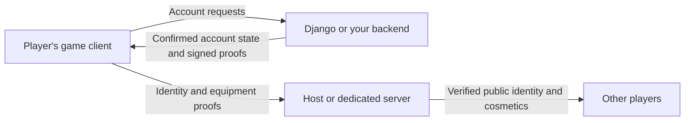

# Multiplayer LiveOps Toolkit

Multiplayer LiveOps Toolkit gives Unity developers ready-to-use systems for player accounts, currencies, shops, cosmetic inventories, equipment, achievements and daily rewards.

It is built for multiplayer games. Players can try on cosmetics locally, save their equipment through a backend, and share their approved appearance with other players. The package includes cosmetic rendering and multiplayer avatar setup. Movement, animation replication and camera controls are also provided as optional integrations.

The goal is to reuse these systems across games: choose the modules you need, replace the art and UI, and build your game's additional features around them. A self-hosted Django backend is included as a working reference; you can connect another backend through the module interfaces.

## Features

| Module | What you can do |
|---|---|
| Identity | Sign players in, maintain their account session and verify their public identity in multiplayer |
| Wallet | Keep backend-confirmed currency balances and convert between currencies at configured rates |
| Shop | Offer individual cosmetics and complete sets, with backend-defined catalogs and multi-currency prices |
| Inventory | Track owned cosmetics and fully owned sets independently of the shop |
| Equipment | Equip and unequip items or sets, save loadouts, apply slot conflicts and preview looks locally |
| Achievements | Track supported backend-observable progress and claim configured currency or cosmetic rewards |
| Daily Rewards | Show monthly calendars, record attendance and claim rewards using the backend's date |
| Multiplayer avatars | Spawn verified players and share their public identity and approved equipped cosmetics, including with late joiners |

### Visual customization

The package supplies the rendering needed to show equipped cosmetics and shop previews:

- Attach accessories to configured points on a character, or replace selected base meshes.
- Replace skinned body parts for complete outfits using compatible rigs.
- Hide the corresponding base meshes while replacements are equipped and restore them when removed.
- Configure slots and conflicts, such as headwear excluding hair.
- Preview an item or set without buying it, saving it or changing what other players see.
- Replace the base character and add cosmetics or slots through visual catalogs, rig bindings and matching backend configuration.

Skinned replacements need compatible authored meshes and bind poses. Slot conflicts are explicit rules; the toolkit does not detect intersecting geometry automatically.

### Adapt it to your game

Initialize only the modules your game uses. Their services are independent of the sample UI, so you can build your own screens and observe state changes through events. Authentication, backend adapters and cosmetic rendering can be replaced to fit your project.

The supplied multiplayer integration uses Netcode for GameObjects and supports host/client and dedicated-server sessions. You can keep the included movement, animation replication and third-person camera, or use your own.

## What's in this repository?

| Part | What it contains |
|---|---|
| **Unity package** | Reusable modules, cosmetic rendering, multiplayer avatar integration, optional character controls and portable tests |
| **Full Demo** | A complete playable scene with modular character art, animated avatars, cosmetics, catalogs and TextMeshPro UI |
| **Django reference backend** | Working account authentication, economy, ownership, equipment, achievements, daily rewards and admin/content tools |

The Full Demo shows the systems working together: sign in, join another player, browse categorized items and outfits, preview a look, buy and equip it, then see the approved change on the other instance. It also includes currency conversion, achievements, daily rewards and a development reset.

The same demo is available in two places: directly under the repository's `Unity/Assets/` folder, and as the package's single optional **Full Demo** sample. Import the sample and open its scene. The backend runs separately.

## How it works

Each client talks directly to the backend for its own account. The backend decides prices, balances, ownership and rewards. The host or dedicated server verifies signed identity/equipment proofs before spawning players and sharing their approved appearance.

Cosmetic previews stay on the local client. Wallet balances, full inventories, credentials and private account progress are not replicated to other players.

Account authority and gameplay authority are separate. The supplied movement is client-authoritative; this toolkit does not provide an authoritative combat or match simulation. See the [verification protocol](Documentation/multiplayer-identity-verification.md) for details.

## Current support

- **Unity:** 2022.3; developed and tested with 2022.3.33f1.
- **Platforms:** macOS desktop and Android builds. Android is verified on an ARM64 Android 13 emulator using Unity 2022.3.33f1, NGO 1.9.1, IL2CPP and OpenGL ES 3. Physical Android devices, Unity 6 Android, iOS, Windows, Linux and Unity's dedicated-server build target should work but are untested.
- **Inventory:** cosmetic ownership. General item stacks, consumables and equipment stats are outside the current implementation.
- **Backend:** Django is a reference implementation. Games choose their own hosting, database operations and additional economy policies.
- **Availability:** terminal authentication/renewal and handshake failures disconnect. Immediate detection of an idle backend outage remains an open gap.

The support and limitations listed above describe the scope of v0.1.0.

## Get started

The Unity project is in **`Unity/`**. Add that folder to Unity Hub; the repository root holds the backend, documentation and development tooling.

**Try the complete repository demo:** follow [Run the demo](Documentation/getting-started.md) to set up the backend, create accounts, configure public verification trust and run two instances.

**Build and run on Android:** follow [Android setup](Documentation/android.md) for SDK/emulator installation, backend forwarding, public trust and APK build settings.

**Install in a fresh Unity project:** choose the [`.unitypackage` download](https://github.com/Alchemishty/Multiplayer-LiveOps-Toolkit/releases) with its [import guide](Documentation/unitypackage.md), or use [Package Manager integration](Documentation/package-integration.md). Both formats include Full Demo and require the documented Unity dependencies/TMP Essentials.

**Build your own integration:** start with the [package guide](Unity/Packages/com.alchemishty.multiplayer-liveops-toolkit/Documentation~/index.md), [visual customization](Unity/Packages/com.alchemishty.multiplayer-liveops-toolkit/Documentation~/equipment-visuals.md) and [multiplayer avatar integration](Unity/Packages/com.alchemishty.multiplayer-liveops-toolkit/Documentation~/full-demo.md).

## Development and next steps

See the [roadmap](Documentation/roadmap.md) for Unity 6 support, inventory beyond cosmetics, admin/dashboard editing and current platform/availability gaps. The [architecture decisions](Documentation/architecture-decisions.md) explain the choices behind account authority, multiplayer verification and recovery.

Browse the [project documentation](Documentation/README.md) for all usage guides.

For contributors, [technical architecture](docs/architecture.md) and [testing](docs/testing.md) explain implementation and verification. [AGENTS.md](AGENTS.md), [conventions](docs/conventions.md) and [enforcement](enforcement/) record the project's development rules.

The reusable package lives in `Unity/Packages/com.alchemishty.multiplayer-liveops-toolkit/`; the demo is under `Unity/Assets/`, and the backend is under `backend/`. Demo changes are synchronized to the package sample with `python3 tools/sync_full_demo.py`.

## License

Toolkit code is licensed under [MIT](LICENSE). Demo art and third-party dependencies retain their own licenses; see [demo credits](Unity/Assets/Models/CREDITS.md).
